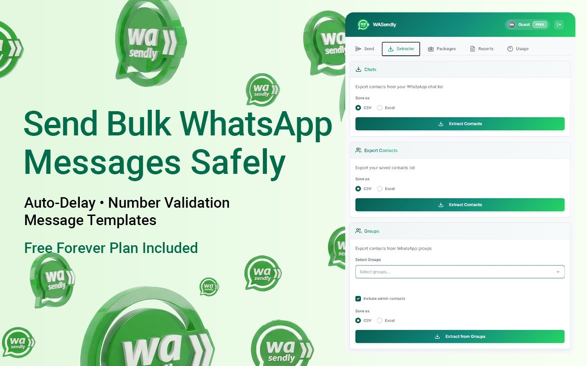
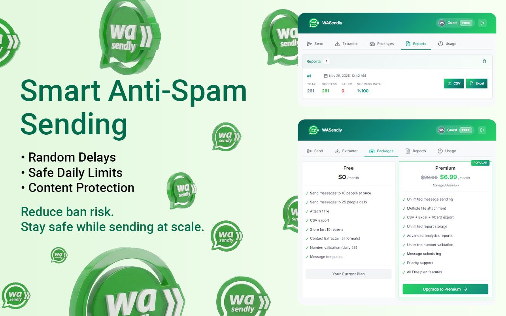

# WASendly: WhatsApp Bulk Message Sender for Chrome

WASendly is a Chrome extension that sends a WhatsApp message to a list of contacts from WhatsApp Web, one by one, with pauses in between. Import your numbers from Excel or CSV, write the message once, and the extension works through the list. It is built for businesses that message their own customers: order updates, appointment reminders, announcements to people who opted in.

**[Install from the Chrome Web Store](https://chromewebstore.google.com/detail/nhdbfplejhncelchgoknmkmndladimmp?utm_source=github&utm_medium=readme&utm_campaign=wasendly_bulk_sender)** | **[Full guide and FAQ](https://www.addonschrome.com/extensions/wasendly-whatsapp-bulk-message-sender.html?utm_source=github&utm_medium=readme&utm_campaign=wasendly_bulk_sender)** | **[Video demo](https://www.youtube.com/watch?v=_wuMkj7Vh-4)**

This repository is the public home for WASendly documentation, release notes and the issue tracker. The extension itself is distributed through the Chrome Web Store.

## Features

- Import contacts from an Excel or CSV file
- Send to numbers that are not saved in your phone book
- Message templates
- Number validation before sending
- Randomized delays between messages, so sending is paced and not a burst
- Sending reports
- Runs in your own WhatsApp Web session, in your browser

## How to use it

1. Install WASendly from the [Chrome Web Store](https://chromewebstore.google.com/detail/nhdbfplejhncelchgoknmkmndladimmp?utm_source=github&utm_medium=readme&utm_campaign=wasendly_bulk_sender).
2. Open WhatsApp Web in Chrome and log in.
3. Import your contact list from Excel or CSV, or paste the numbers.
4. Write your message or pick a template.
5. Set the delay and start sending.

The [full guide](https://www.addonschrome.com/extensions/wasendly-whatsapp-bulk-message-sender.html?utm_source=github&utm_medium=readme&utm_campaign=wasendly_bulk_sender) explains the file format and the delay settings.

## Read this before you send

WhatsApp restricts and bans accounts that send unsolicited bulk messages. Delays reduce the technical risk, but they do not make spam acceptable.

- Message only people who gave you their number and expect to hear from you
- Start with small batches and keep the delays long
- Say who you are and give people a way to stop receiving messages
- For high-volume or automated business messaging, the official WhatsApp Business Platform is the right tool

## Pricing

WASendly is free to install and includes a free plan. Paid plans are listed on the [extension page](https://www.addonschrome.com/extensions/wasendly-whatsapp-bulk-message-sender.html?utm_source=github&utm_medium=readme&utm_campaign=wasendly_bulk_sender).

## Screenshots

## Support and feedback

Found a bug or want a feature? [Open an issue](../../issues) in this repository. Please include your Chrome version and the steps that led to the problem.

## Disclaimer

WASendly is an independent tool and is not affiliated with, endorsed by or sponsored by WhatsApp or Meta. WhatsApp is a trademark of its owner. You are responsible for complying with the WhatsApp terms and the messaging laws that apply to you.

---

Built and maintained by [Addons Chrome](https://www.addonschrome.com/?utm_source=github&utm_medium=readme&utm_campaign=wasendly_bulk_sender).
